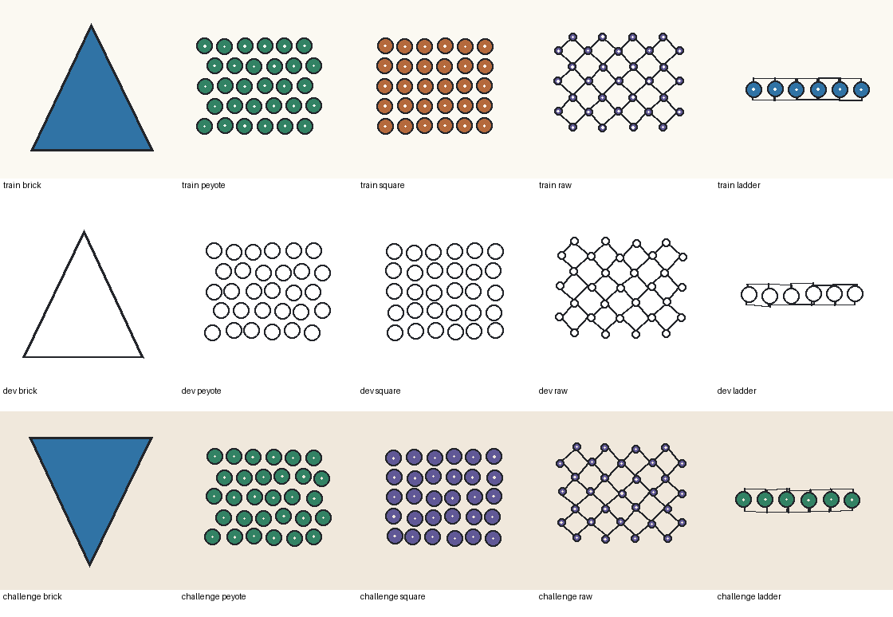

# Image-stitch-v1: completed training and image evaluation

Completed on 2026-11-04 using one eligible free Colab Tesla T4. No paid upgrade, hosted inference API, or automatic deployment was used. The original text adapter is unchanged. The new adapter is experimental: it generates more supported patterns, but it is worse at declining some unsupported requests.

## Results

Exact recipe means the stitch, shape, requested width and row count all match the frozen target. Rejections count as correct only when the target requires clarification.

| Check | Original text adapter | Image-trained continuation |
| --- | ---: | ---: |
| Synthetic development images | 15/28 | **24/28** |
| Frozen synthetic challenge images | 12/40 | **26/40** |
| Supported challenge requests only | 3/30 | **20/30** |
| Unsupported challenge requests correctly declined | **9/10** | 6/10 |
| Text development requests, same image-aware system | 21/22 | 21/22 |
| Previously debugged green triangle | 0/1 | **1/1** |

The frozen base without either adapter scored 16/28 on development images. The parent text model's earlier 22/22 text score used its earlier system prompt; the comparable text baseline under this experiment's image-aware prompt is 21/22.

| Challenge family | Before | After |
| --- | ---: | ---: |
| Brick | 0/6 | 3/6 |
| Peyote | 0/6 | 2/6 |
| Square | 3/6 | 3/6 |
| RAW | 0/6 | **6/6** |
| Ladder | 0/6 | **6/6** |

These are synthetic references, not real photos or physical samples. Development includes five distinct positive target recipes; the challenge includes nine. Repeated styles/seeds are not independent pattern specifications. Recipe groups, image seeds and pixel hashes were isolated across training/development/challenge. The known regression is reported separately because it had already been debugged and its recipe overlaps earlier text training.

## What was trained

- 140 original synthetic training images: 100 positive examples and 40 clarification cases.
- 88 training-only text examples for retention, for 228 rows total.
- 28 development and 40 challenge images, frozen before weight updates.
- Continued the existing language-attention Qwen LoRA for two fixed epochs (58 optimizer updates), seed 43 and learning rate 5e-5. The base and vision tower stayed frozen. Assistant-only labels included image tokens in the prompt; no prompt/image tokens were training targets.
- Every unique positive golden recipe was compiled before training and checked against the five-pass assembly preference. No physical-success labels were invented.

The images illustrate outlines or bead arrangements; requested bead dimensions come from text. The task does not trace arbitrary silhouettes, reproduce image colors, generate whole 3D subjects or finish hybrid joints.

## Remaining failures

See [all scored failure records](failures.jsonl) and the raw predictions below. Some valid wider brick, peyote and square requests are declined. Ambiguous solid rectangles can be incorrectly assigned peyote. The model can still propose an invalid odd-width peyote recipe or invent dimensions for a missing-size request; the compiler rejected those invalid recipes during this evaluation.

All 43 compiled development/challenge image drafts stayed within five assembly passages per bead. **This includes four drafts with incorrect image interpretations.** A valid compiled route is not proof of choosing the right stitch or of physical beadability. Starting and finishing remain unplanned, and the seed-bead/needle/thread combination has not been physically sampled.

## Image-dependence diagnostics

The predefined four-case image-swap check used identical text/dimensions with different images and scored 1/4. Replacing those reference images with blank images scored 0/4 against the original targets; all blank inputs requested clarification. This small diagnostic does not establish broad image understanding. Its low swap score reflects the remaining challenge failures. No challenge examples were moved into training or removed from the reported denominator.

## Saved artifacts and verification

The [audit](audit.json) checked all **218 saved predictions** across 11 sets against frozen inputs, raw decoded outputs, independently recompiled recipes, summaries and comparison bindings. All nine recorded source/data hashes matched. A second local check reproduced every prediction-file checksum and exact-recipe count from the exported evidence.

[Numeric weight verification](weight-change.json), using the same CPU comparison as [this reproducible script](../../verify_image_weights.py), confirmed that 3,211,260 of 3,211,264 values changed across all 112 adapter tensors. The parent file still matches its pre-training SHA256; the new file matches the audited adapter hash. Full model weights remain in the user's Drive, not this public repository.

- Parent SHA256: `7c63aeaf0d9560d04cb040dcb875a33211be5e6b893c59b2567545e9c307fdb8`
- New adapter SHA256: `4037c83f7e07b9bf6c11361b433eaef416c344d1dbe8c9f6c671760a3adc00f1`
- Frozen training source: `7d12a28cb551196fc0a3a8e2b17315af6b19c86c`
- Initial audit tools: `3c68b4b31ffffe0572357ddddd0230ba260ed9eb`
- Compatible UI/inference tools: `71b025448be8658035c504effd136ec689ea0567` (the auditor source is unchanged; inference preparation matches the benchmark).

The complete [comparison](comparison.json), [metadata](metadata.json), [training metrics](training-complete.json), and per-set `predictions.jsonl` files are archived here. They contain only authored synthetic evaluation requests, never user uploads. The adapter and checkpoints are saved separately under `MyDrive/Beadform-free-qwen/runs/image-stitch-v1`.

## Try the new image adapter

[Open the free image notebook](https://colab.research.google.com/github/c-tustin/beadform/blob/main/training/colab_image_stitch.ipynb), use the same Drive account, and run its setup and final interface cell. An existing completed comparison is preserved; the training cell does not retrain a completed run.

Click **Use sample triangle**, then **Generate pattern**, or upload a small flat reference and give explicit bead dimensions. The old text adapter remains available in the earlier interface. The app's default model has not changed.

The [verified sample](sample-check.json) used the real sample-selection and generation buttons with the new audited weights: [brick recipe](sample/pattern.json), **18 beads**, maximum **3 assembly passes**, [bead-placement chart](sample/bead-chart.svg), and [input reference](sample/reference.png). It is the known regression case, not additional held-out evidence. The clear-reference control and missing-image guard were exercised successfully. Automated native file-picker interaction was not verified; the standard upload control remains available for manual use.

## Next work indicated by this experiment

Improve rejection of ambiguous/unimplemented references and missing dimensions, add valid upper-range dimension combinations without reusing the current challenge as a tuning set, and build a new independent image evaluation including real references. Preserve the current failures. Physically sample routes and finishes before calling patterns beadable. No additional training or app deployment is claimed by this completed experiment.
